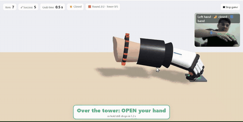
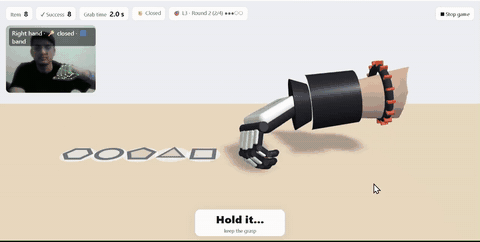

# MyoTrainer

**Virtual prosthesis training with an EMG + FMG sensor band.** (Not related to the Myo armband by Thalmic Labs.)

Train myoelectric hand control before the real prosthesis is ready: a virtual prosthetic hand on a forearm,
driven by camera hand tracking today and by a self-designed EMG + FMG sensor band next, with three therapy games.

**Gameplay videos and 3D band:** https://smit-sakariya-thesis.pages.dev

## Demo

**▶ Play it in your browser:** https://smitsajariya.github.io/MyoTrainer/  
Needs a laptop with a webcam and Chrome or Edge. Click **Start camera**, allow the camera, show your right hand, then pick a game.


| Game 1 · Build a tower | Game 2 · Fruit basket | Game 3 · Match it |
|---|---|---|
|  |  |  |
| [Full video (1:43)](docs/demo/game1_tower.mp4) | [Full video (1:31)](docs/demo/game2_fruit.mp4) | [Full video (2:31)](docs/demo/game3_match.mp4) |

The hand is tracked by the laptop camera; the blue band on the forearm marks where the sensor band will sit.
Each game trains grasp, carry and release, with selectable rounds and "pick it up yourself" reach rounds.

## 3D sensor band

[](https://smitsajariya.github.io/MyoTrainer/hardware/band/band_print_parts.html)

**▶ Turn the band in 3D:** https://smitsajariya.github.io/MyoTrainer/hardware/band/band_print_parts.html  
**Band design (sensors, wiring, ESP32):** https://smitsajariya.github.io/MyoTrainer/docs/band_design/band_design.html

A 3D-printed band for the forearm: 8 pods with 16 force sensors (FSR 402, two per pod), 2 EMG sensors and an ESP32 box.
Printable files are in [`hardware/band/`](hardware/band/) (`band_pod_x8.stl`, `band_button_x16.stl`, `band_box.stl`, `band_box_lid.stl`);
`make_band.py` generates them, so sizes can be changed in one place.

## How it works

M.Sc. thesis project by Smit Sakariya, Analytical Instruments, Measurement and Sensor Technology, Coburg University.

A low-cost band (2 dry EMG sensors + 16 force-sensitive resistors) reads muscle activity on the forearm.
An LDA classifier decodes four movements (rest, open, close, pinch) in real time and drives a virtual
prosthetic hand on a forearm in the browser. Until the band is built, the laptop camera
(MediaPipe hand tracking) gives the same four movements, so the games can already be played and tested.

```
pb/                   shared signal processing and classifiers (offline and real time)
analysis/             Part A: public dataset (MyoKi) experiments | Part B: own recordings
realtime/             real-time server: band / simulator / camera / replay -> classifier -> browser
virtual_hand/         browser app (Three.js): virtual hand, calibration and the three games
firmware/esp32_band/  ESP32 firmware for the band
hardware/band/        printable band parts (STL) and the script that makes them
tests/                end-to-end test and synthetic data generators
docs/                 protocol, shopping list, band design, thesis outline
```

## Run it on your computer

**Install (once):** Python 3.11+, then `python -m pip install -r requirements.txt`.

**Camera mode (no band needed):** run `start_demo.bat` (or `python realtime\server.py --source camera`) and open http://localhost:8000.
- **Start camera** and show your hand: the virtual hand copies every finger, the hand's turn and tilt, and its position.
- **Calibrate movement** maps your real reach to the virtual table; **Calibrate** learns your own open / fist / pinch / rest.
- Pick a game and the rounds you want to play. Results (success, grab time, release time, drops) are saved to `recordings\`.
- **Record my movement** / **Replay** saves and plays back the hand motion, for therapist review.

**Simulated band:** `python realtime\server.py --source sim`, open http://localhost:8000, set Repetitions = 3 and press
**Calibrate**. A model is trained (`models\lda_....joblib`); keys **1-4** (rest, open, close, pinch) then drive the hand through the decoder.

**Real band:** wiring is at the top of `firmware\esp32_band\esp32_band.ino`. Flash it with the Arduino IDE
(board "ESP32 Dev Module"), then run `python realtime\server.py --source serial --port COM5`.

## Thesis experiments

### Part A: public dataset (no hardware)

Download MyoKi participants **P26-P35** (the ones with FMG) from
https://doi.org/10.6084/m9.figshare.28696778 (each file is about 4 GB; start with 3 files).

```
python analysis\run_experiments.py --data-dir D:\MyoKi --subjects P26-P28 --out results_partA
```
The first run is slow (it filters the raw data); features are cached in `results_partA\cache`,
so later runs take seconds. Outputs: CSV tables and thesis figures (`fig_e1...png` etc.).

| Experiment | Question |
|---|---|
| E1 within-subject | EMG vs FMG vs hybrid, full lab setup vs low-cost (2 EMG + 16 FSR) |
| E2 calibration | how many calibration repetitions a new user needs, with/without pre-training on others |
| E3 band rotation | accuracy when the band is put on rotated by one sensor module |
| E4 cross-subject | accuracy for a new user without any calibration |

Test the pipeline without the real data:
```
python analysis\make_synthetic_myoki.py --out synthetic_data --n 4
python analysis\run_experiments.py --data-dir synthetic_data --subjects P26-P29 --out results_test
```

> Check assumption: the loader assumes the 24 FMG columns are grouped 4 per bracelet module in
> module order (`analysis\myoki_loader.py`, `fmg_module_cols`). Verify against Fig. 4 of the MyoKi paper.

### Part B: own sessions (single subject)

Follow `docs\protocol_self_experiment.md`. In the web page use **Record** with a tag such as `day1` or `day3_shift1cm`, then:
```
python analysis\own_experiments.py --rec recordings --out results_partB
```

### Tests

```
python tests\make_sim_sessions.py sim_recordings
python analysis\own_experiments.py --rec sim_recordings --out results_sim
python tests\e2e_sim.py            (needs: pip install playwright && playwright install chromium)
```

## Data and licences
- MyoKi: Andreas et al., *Scientific Data* 12:1507 (2025), CC BY 4.0.
- Three.js (MIT licence) is included in `virtual_hand/vendor`.
