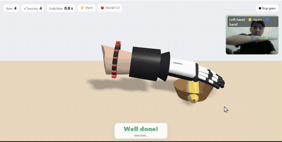
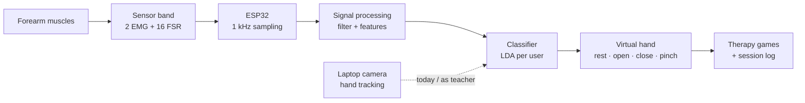
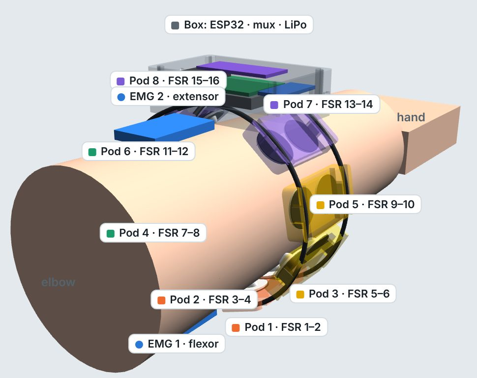

# MyoTrainer

**Virtual prosthesis training with an EMG + FMG sensor band.**
(Not related to the Myo armband by Thalmic Labs.)

MyoTrainer lets a person practise controlling a myoelectric hand prosthesis **before the real prosthesis is ready**.
A virtual prosthetic hand sits on a forearm on screen. The user moves it with their own muscle signals and trains
everyday tasks (grasp, carry, release) in short therapy games, at home, with results a therapist can review.

M.Sc. thesis project by Smit Sakariya · Analytical Instruments, Measurement and Sensor Technology · Coburg University of Applied Sciences.

## Demo

**▶ Play it in your browser:** https://smitsajariya.github.io/MyoTrainer/
(laptop with webcam, Chrome or Edge: **Start camera**, allow the camera, show your right hand, pick a game)

| Game 1 · Build a tower | Game 2 · Fruit basket | Game 3 · Match it |
|---|---|---|
|  |  |  |
| [Full video (1:43)](docs/demo/game1_tower.mp4) | [Full video (1:31)](docs/demo/game2_fruit.mp4) | [Full video (2:31)](docs/demo/game3_match.mp4) |

In the videos the hand is tracked by the laptop camera; the blue band on the forearm marks where the sensor band will sit.

## The problem

A myoelectric prosthesis opens and closes when the user tenses forearm muscles. Learning this takes weeks of practice,
but practice usually starts only after the socket and the prosthesis are made. Patients lose motivation, and therapists
have few objective numbers about progress. MyoTrainer moves the practice earlier and makes it measurable.

## How it works



1. **Sense.** The band measures two kinds of muscle signal: **EMG** (electrical activity, 2 sensors on the flexor and
   extensor side) and **FMG** (force myography: 16 force-sensitive resistors that feel the muscles bulge under the band).
2. **Process.** EMG is band-pass filtered (20-450 Hz) with a 50 Hz notch. Every 50 ms a 200 ms window is cut and turned
   into features (MAV, RMS, waveform length, zero crossings, slope sign changes; mean pressure per FSR).
3. **Decode.** A small **LDA classifier** trained for each user maps the features to four commands:
   rest, open, close (power grip) and pinch. A majority vote over 3 windows keeps the hand steady.
4. **Calibrate.** The user copies each gesture shown on screen for a few seconds (about 20 s in total).
   The camera can act as a **teacher**: it labels what the healthy hand really does, so the band learns from correct labels.
5. **Move the virtual hand.** The decoded command drives a 3D prosthetic hand (Three.js) in real time. In camera mode
   the hand also follows position and tilt, so reaching movements can be trained.
6. **Train and measure.** Three games train grasp, carry and release. Each session logs success rate, grab time,
   release time, wrong grasps and drops.

**Today vs. next:** the band is designed and ready to print; until it is built, the laptop camera (MediaPipe hand
tracking) produces the same four commands, so the whole system, the games and the logging already work end to end.

## Features

- **Three therapy games** with selectable rounds:
  - *Build a tower*: stack blocks, precision release.
  - *Fruit basket*: grasp fruit, carry it, drop it into the basket.
  - *Match it*: place objects on the matching colour, then shape, then colour + shape.
- **"Pick it up yourself" rounds**: the object lies on the table and the user has to reach for it.
- **Patient-friendly settings**: large targets, slow pace, auto-drop when the object is held still over the target
  (for users who cannot open the hand yet), sounds and clear prompts.
- **Movement calibration**: maps the user's real reach to the virtual table, with limits so the arm never goes through the table.
- **Record and replay** of the hand movement, for therapist review.
- **Session logs** (CSV / JSON) for analysis.

## 3D sensor band

[](https://smitsajariya.github.io/MyoTrainer/hardware/band/band_print_parts.html)

**▶ Turn the band in 3D:** https://smitsajariya.github.io/MyoTrainer/hardware/band/band_print_parts.html
· **Design notes (sensors, wiring, ESP32):** https://smitsajariya.github.io/MyoTrainer/docs/band_design/band_design.html

| Part | Count | What it does |
|---|---|---|
| Sensor pod (TPU) | 8 | holds 2 FSR 402 each, one row near the elbow, one near the wrist |
| Pressure button | 16 | small dome on each FSR, focuses the muscle pressure on the sensor |
| EMG sensor (SEN0240) | 2 | flexor (palm side) and extensor (back of the forearm) |
| Electronics box (PETG) | 1 | ESP32, 16-channel multiplexer (CD74HC4067), LiPo battery, USB-C charger |

All parts are generated by [`hardware/band/make_band.py`](hardware/band/make_band.py) (Python, manifold3d), so sizes
change in one place. Print-ready STL files are in [`hardware/band/`](hardware/band/); the parts list is in
[`docs/shopping_list.md`](docs/shopping_list.md). The firmware streams over USB serial today; Bluetooth is planned.

## Run it on your computer

**Install (once):** Python 3.11+, then `python -m pip install -r requirements.txt`.

| Mode | Command | Use |
|---|---|---|
| Camera | `start_demo.bat` or `python realtime\server.py --source camera` | play without any hardware |
| Simulated band | `python realtime\server.py --source sim` | test calibration and the classifier; keys 1-4 change the simulated muscles |
| Real band | `python realtime\server.py --source serial --port COM5` | ESP32 band (flash `firmware/esp32_band` with the Arduino IDE first) |
| Replay | `python realtime\server.py --source replay --file recordings\x.csv` | play back a recorded session |

Then open http://localhost:8000 in Chrome.

## Repository structure

```
pb/                   signal processing and classifiers (shared by offline analysis and real time)
realtime/             real-time server: band / simulator / camera / replay -> classifier -> browser
virtual_hand/         browser app (Three.js): virtual hand, calibration and the games
firmware/esp32_band/  ESP32 firmware for the band
hardware/band/        band CAD script and printable STL files
analysis/             thesis experiments (public dataset and own recordings)
tests/                end-to-end tests and synthetic data generators
docs/                 band design, protocol, shopping list, thesis outline, demo media
```

## Thesis experiments

### Part A: public dataset (no hardware)

Download MyoKi participants **P26-P35** (the ones with FMG) from
https://doi.org/10.6084/m9.figshare.28696778 (each file is about 4 GB; start with 3 files).

```
python analysis\run_experiments.py --data-dir D:\MyoKi --subjects P26-P28 --out results_partA
```
The first run is slow (it filters the raw data); features are cached in `results_partA\cache`,
so later runs take seconds. Outputs: CSV tables and thesis figures (`fig_e1...png` etc.).

| Experiment | Question |
|---|---|
| E1 within-subject | EMG vs FMG vs hybrid, full lab setup vs low-cost (2 EMG + 16 FSR) |
| E2 calibration | how many calibration repetitions a new user needs, with/without pre-training on others |
| E3 band rotation | accuracy when the band is put on rotated by one sensor module |
| E4 cross-subject | accuracy for a new user without any calibration |

Test the pipeline without the real data:
```
python analysis\make_synthetic_myoki.py --out synthetic_data --n 4
python analysis\run_experiments.py --data-dir synthetic_data --subjects P26-P29 --out results_test
```

> Check assumption: the loader assumes the 24 FMG columns are grouped 4 per bracelet module in
> module order (`analysis\myoki_loader.py`, `fmg_module_cols`). Verify against Fig. 4 of the MyoKi paper.

### Part B: own sessions (single subject)

Follow [`docs/protocol_self_experiment.md`](docs/protocol_self_experiment.md). In the web page use **Record** with a tag
such as `day1` or `day3_shift1cm`, then:
```
python analysis\own_experiments.py --rec recordings --out results_partB
```

### Tests

```
python tests\make_sim_sessions.py sim_recordings
python analysis\own_experiments.py --rec sim_recordings --out results_sim
python tests\e2e_sim.py            (needs: pip install playwright && playwright install chromium)
```

## Status

- [x] Real-time pipeline, classifier and virtual hand
- [x] Camera mode, calibration, three games, logging
- [x] Band design (CAD, STL, firmware)
- [ ] Print and assemble the band, first recordings
- [ ] Evaluation on the public dataset (Part A) and own sessions (Part B)

## Built with

Python (NumPy, SciPy, scikit-learn) · JavaScript · Three.js · MediaPipe Hands · WebSocket · ESP32 (Arduino) · manifold3d / trimesh

## Data and licences

- MyoKi dataset: Andreas et al., *Scientific Data* 12:1507 (2025), CC BY 4.0.
- Three.js (MIT licence) and MediaPipe (Apache 2.0) are included in `virtual_hand/vendor`.
